  

  <a href="mailto:denisfilhocg@gmail.com">denisfilhocg@gmail.com</a> &nbsp;·&nbsp; Uberlândia, MG

### Sobre

Desenvolvo sistemas web de ponta a ponta: API em Python/FastAPI, front-end em Next.js, banco PostgreSQL e o servidor Linux onde tudo roda. Desde 2024 mantenho produtos próprios em fintech, energia solar e hospedagens. Antes disso, estagiei como desenvolvedor full stack em uma startup.

Estudo Ciência da Computação na UNITRI e procuro uma vaga de desenvolvedor para trabalhar em time.

### Projetos

  
  

  
  

O código desses projetos fica em repositórios privados, porque são sistemas de empresas em operação. Abaixo mostro como duas partes deles funcionam.

### Como publico o NextSync

Cada push na branch principal passa pelo GitHub Actions e vai para o servidor por um script de deploy. Depois da publicação, um health check testa a API. Se ela não responder, o script volta sozinho para a versão anterior.

### Validação de documentos no Clube da Energia

O cliente envia os documentos. O navegador faz as primeiras checagens, a IA analisa e dá um score de confiança, e o que fica abaixo do score mínimo vai para uma fila de revisão manual.

### Stack

  Para conversar sobre uma vaga ou um projeto: <a href="mailto:denisfilhocg@gmail.com">denisfilhocg@gmail.com</a>

