  

  <a href="https://www.linkedin.com/in/denis-filho-cunha-godoi-9a81b72b9/">LinkedIn</a> &nbsp;·&nbsp;
  <a href="mailto:denisfilhocg@gmail.com">denisfilhocg@gmail.com</a> &nbsp;·&nbsp;
  Brazil (UTC−3) &nbsp;·&nbsp;
  <a href="#versão-em-português">Versão em português</a>

### About

I build web products end to end: the API in Python/FastAPI, the front end in Next.js, the PostgreSQL database and the Linux server it all runs on. Since 2024 I have built my own products in fintech, solar energy and short-term rentals. Before that, I was a full stack intern at a startup.

I'm a Computer Science student at UNITRI, looking for a **remote full stack role**. I'm also open to **front-end** or **Python back-end with DevOps** positions.

### Projects

  
  

  
  

The code for these projects lives in private repositories because it belongs to the companies. Below is how two parts of them work.

### Luck Finance deploy pipeline

Every push to the main branch went through GitHub Actions and reached the server through a deploy script. After each release, a health check called the API. If it didn't respond, the script rolled back to the previous version on its own.

### Document validation at Clube da Energia

Customers upload their documents. The browser runs the first checks, an AI model analyzes them and returns a confidence score, and anything below the minimum score goes to a manual review queue.

### Stack

### Versão em português

Clique para ler em português

 

Desenvolvo sistemas web de ponta a ponta: API em Python/FastAPI, front-end em Next.js, banco PostgreSQL e o servidor Linux onde tudo roda. Desde 2024 desenvolvi produtos próprios em fintech, energia solar e hospedagens. Antes disso, estagiei como desenvolvedor full stack em uma startup.

Estudo Ciência da Computação na UNITRI e busco uma **vaga remota de desenvolvedor full stack**. Também tenho interesse em vagas de **front-end** ou de **back-end Python com DevOps**.

**Projetos**

- **Luck Finance (2024 – 2026):** plataforma de gestão financeira pessoal com IA. Fiz o produto inteiro, da API ao deploy. Na validação, teve 83 cadastros, 35% com alta intenção de compra.
- **Clube da Energia (MVP):** marketplace de energia solar compartilhada, com API dividida em serviços e validação de documentos por IA com fila de revisão humana.
- **Welcome Stays (2026):** sistemas internos de uma empresa de hospedagem por temporada e extrato dos proprietários gerado a partir das reservas do Airbnb. Em um mês: 33 hospedagens, R$ 11,3 mil processados e 83% de ocupação.
- **GoNFC:** site, API, painel do vendedor e app da equipe de vendas de uma marca de placas NFC.

O código desses projetos fica em repositórios privados, porque pertence às empresas.

  Let's talk about a role or a project: <a href="mailto:denisfilhocg@gmail.com">denisfilhocg@gmail.com</a> · <a href="https://www.linkedin.com/in/denis-filho-cunha-godoi-9a81b72b9/">LinkedIn</a>

